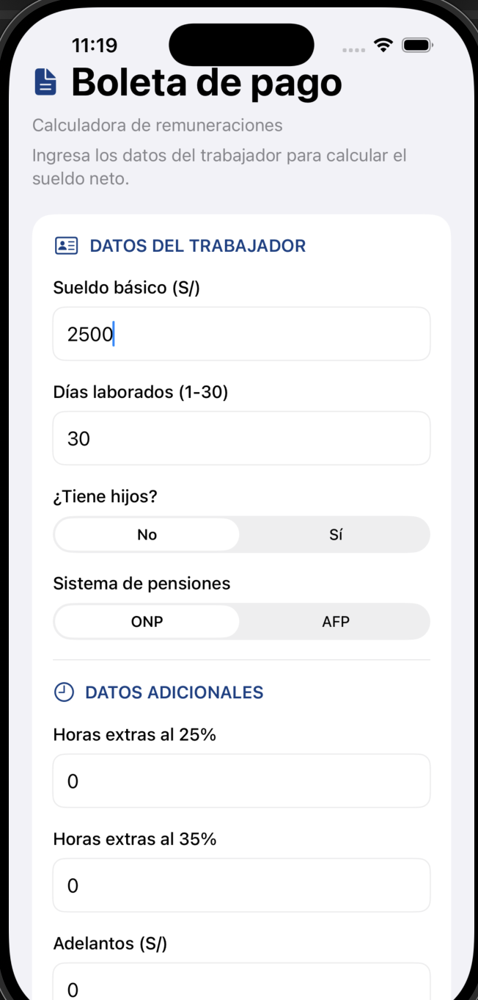
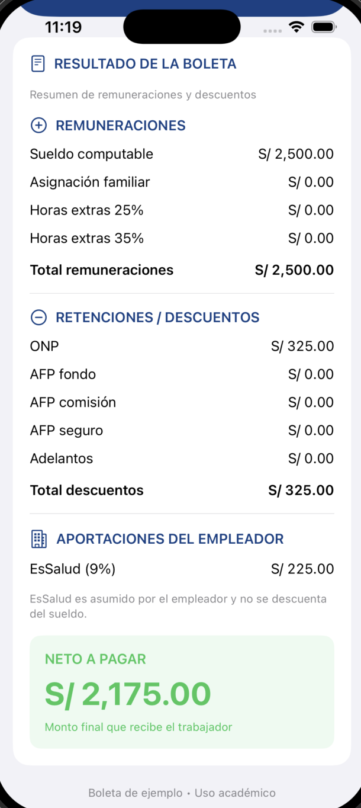
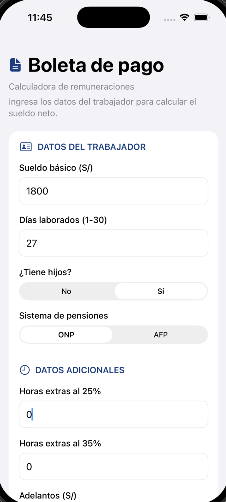
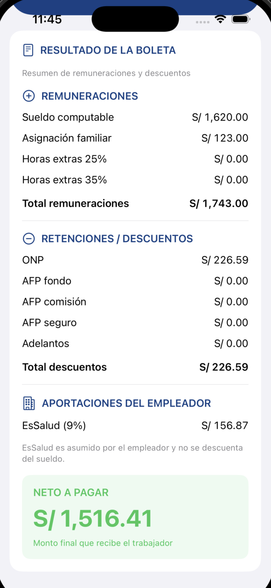
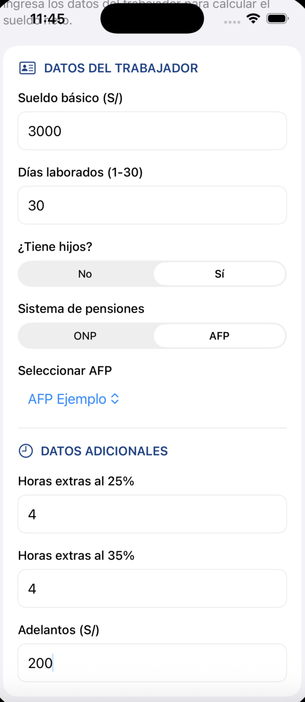
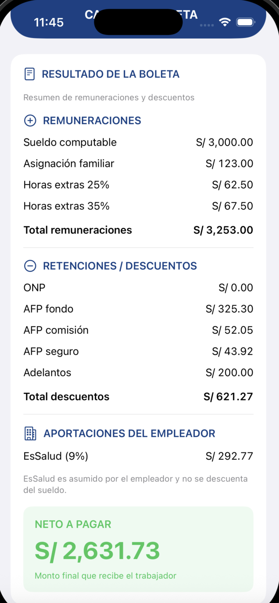
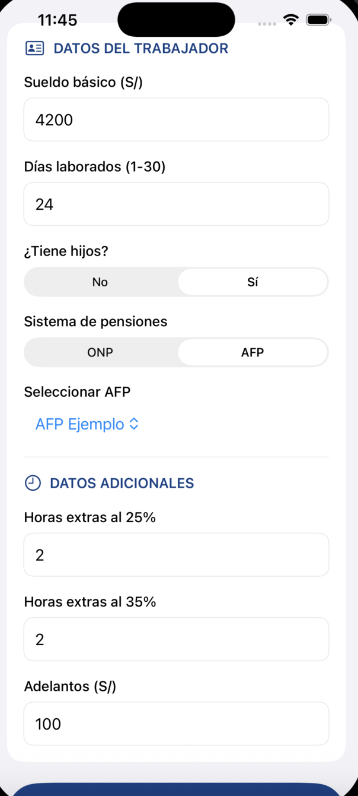
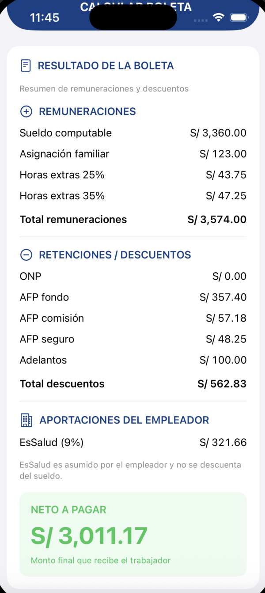

# Laboratorio 09 - Boleta de Pago en SwiftUI

**Curso:** Programación en Móviles Avanzado  
**Institución:** TECSUP  
**Estudiante:** Yefry Calderón  
**Tecnología:** Swift y SwiftUI  
**Plataforma:** iOS  
**Entorno de desarrollo:** Xcode  
**Simulador:** iPhone 17 Pro  

---

## 1. Descripción del proyecto

BoletaPago es una aplicación móvil desarrollada con SwiftUI que permite calcular una boleta de pago simplificada de un trabajador.

La aplicación recibe los datos ingresados por el usuario, calcula sus remuneraciones, descuentos pensionarios y aportaciones del empleador, y muestra el monto neto a pagar.

El objetivo es aplicar estructuras, clases, colecciones, validaciones y operaciones matemáticas en Swift, manteniendo separada la lógica de cálculo de la interfaz gráfica.

La aplicación presenta el formulario y los resultados en una sola pantalla, utilizando un ScrollView para facilitar la navegación.

## 2. Funcionalidades implementadas

- Registro del sueldo básico mensual.
- Ingreso de días laborados entre 1 y 30.
- Selección de asignación familiar mediante la opción de hijos.
- Selección del sistema de pensiones ONP o AFP.
- Selección de AFP Ejemplo cuando corresponde.
- Cálculo de horas extras con recargos del 25 % y 35 %.
- Registro de adelantos de sueldo.
- Cálculo de remuneraciones totales.
- Cálculo de descuentos ONP y AFP.
- Cálculo de la aportación EsSalud.
- Cálculo del neto a pagar.
- Validación de los datos ingresados.
- Mensajes de error ante valores incorrectos.
- Limpieza de resultados anteriores cuando se modifican los datos.
- Visualización de remuneraciones, descuentos y aportaciones.

## 3. Tecnologías utilizadas

| Tecnología | Utilización |
|---|---|
| Swift | Lenguaje de programación |
| SwiftUI | Construcción de la interfaz gráfica |
| Xcode | Desarrollo y ejecución |
| iOS Simulator | Pruebas de la aplicación |
| Git | Control de versiones |
| GitHub | Almacenamiento del código fuente |

## 4. Estructura de la aplicación

El proyecto utiliza tres archivos Swift principales.

### BoletaPagoApp.swift

Contiene el punto de entrada de la aplicación y presenta la vista principal mediante `WindowGroup`.

### ContentView.swift

Implementa la interfaz gráfica utilizando componentes SwiftUI:

- Text
- TextField
- Picker
- Button
- VStack
- HStack
- ScrollView
- @State

También gestiona los datos ingresados, las validaciones y la presentación de resultados.

### Boleta.swift

Contiene los modelos de datos, parámetros de cálculo y la clase Boleta, encargada de realizar las operaciones de remuneraciones, descuentos y aportaciones.

Para los cálculos monetarios se utiliza `Decimal` y se redondea cada concepto a dos decimales antes de realizar las sumas correspondientes.

## 5. Fórmulas utilizadas

| Concepto | Fórmula |
|---|---|
| Sueldo computable | Sueldo básico / 30 × días laborados |
| Asignación familiar | RMV × 10 % |
| Valor hora | Sueldo básico / 30 / 8 |
| Horas extras 25 % | Valor hora × 1.25 × horas |
| Horas extras 35 % | Valor hora × 1.35 × horas |
| Total remuneraciones | Suma de conceptos remunerativos |
| ONP | Total remuneraciones × 13 % |
| AFP fondo | Total remuneraciones × 10 % |
| AFP comisión | Total remuneraciones × 1.60 % |
| AFP seguro | Total remuneraciones × 1.35 % |
| EsSalud | Total remuneraciones × 9 % |
| Total descuentos | Descuentos pensionarios + adelantos |
| Neto a pagar | Total remuneraciones - total descuentos |

### Parámetros académicos

Se utilizan los siguientes valores establecidos en la actividad:

- RMV: S/ 1,230.00
- Asignación familiar: S/ 123.00
- ONP: 13 %
- EsSalud: 9 %
- AFP Ejemplo: fondo 10 %, comisión 1.60 % y seguro 1.35 %

Las tasas de AFP Ejemplo son valores ficticios para las pruebas del laboratorio.

EsSalud representa una aportación del empleador y no se descuenta del sueldo del trabajador.

## 6. Validaciones implementadas

La aplicación comprueba las siguientes condiciones:

- El sueldo básico debe ser mayor que cero.
- Los días laborados deben estar entre 1 y 30.
- Las horas extras no pueden tener valores negativos.
- Los adelantos no pueden ser negativos.
- Los campos numéricos obligatorios deben contener valores válidos.
- La AFP seleccionada debe existir en los parámetros configurados.

Cuando se detecta un dato incorrecto, se muestra un mensaje y se cancela el cálculo.

Los resultados anteriores se eliminan cuando se modifica la información del formulario.

---

## 7. Caso de prueba 1 - ONP sin hijos

### Datos ingresados

| Campo | Valor |
|---|---|
| Sueldo básico | S/ 2,500.00 |
| Días laborados | 30 |
| Tiene hijos | No |
| Sistema de pensiones | ONP |
| Horas extras 25 % | 0 |
| Horas extras 35 % | 0 |
| Adelantos | S/ 0.00 |

### Resultados calculados

| Concepto | Resultado |
|---|---:|
| Sueldo computable | S/ 2,500.00 |
| Asignación familiar | S/ 0.00 |
| Horas extras 25 % | S/ 0.00 |
| Horas extras 35 % | S/ 0.00 |
| Total remuneraciones | S/ 2,500.00 |
| ONP (13 %) | S/ 325.00 |
| Total descuentos | S/ 325.00 |
| EsSalud (9 %) | S/ 225.00 |
| **Neto a pagar** | **S/ 2,175.00** |

**Verificación:** el resultado coincide con el valor esperado del caso 1 proporcionado en el laboratorio.

### Evidencia 1: Formulario

### Evidencia 2: Resultado de la boleta

---

## 8. Caso de prueba 2 - ONP con hijos y días incompletos

### Datos ingresados

| Campo | Valor |
|---|---|
| Sueldo básico | S/ 1,800.00 |
| Días laborados | 27 |
| Tiene hijos | Sí |
| Sistema de pensiones | ONP |
| Horas extras 25 % | 0 |
| Horas extras 35 % | 0 |
| Adelantos | S/ 0.00 |

### Resultados calculados

| Concepto | Resultado |
|---|---:|
| Sueldo computable | S/ 1,620.00 |
| Asignación familiar | S/ 123.00 |
| Horas extras 25 % | S/ 0.00 |
| Horas extras 35 % | S/ 0.00 |
| Total remuneraciones | S/ 1,743.00 |
| ONP (13 %) | S/ 226.59 |
| Total descuentos | S/ 226.59 |
| EsSalud (9 %) | S/ 156.87 |
| **Neto a pagar** | **S/ 1,516.41** |

**Verificación:** el cálculo de referencia coincide con el resultado esperado del caso 2 proporcionado en el laboratorio.

### Evidencia 1: Formulario

### Evidencia 2: Resultado de la boleta

---

## 9. Caso de prueba 3 - AFP, horas extras y adelanto

### Datos ingresados

| Campo | Valor |
|---|---|
| Sueldo básico | S/ 3,000.00 |
| Días laborados | 30 |
| Tiene hijos | Sí |
| Sistema de pensiones | AFP |
| AFP seleccionada | AFP Ejemplo |
| Horas extras 25 % | 4 |
| Horas extras 35 % | 4 |
| Adelantos | S/ 200.00 |

### Resultados calculados

| Concepto | Resultado |
|---|---:|
| Sueldo computable | S/ 3,000.00 |
| Asignación familiar | S/ 123.00 |
| Horas extras 25 % | S/ 62.50 |
| Horas extras 35 % | S/ 67.50 |
| Total remuneraciones | S/ 3,253.00 |
| AFP fondo (10 %) | S/ 325.30 |
| AFP comisión (1.60 %) | S/ 52.05 |
| AFP seguro (1.35 %) | S/ 43.92 |
| Adelantos | S/ 200.00 |
| Total descuentos | S/ 621.27 |
| EsSalud (9 %) | S/ 292.77 |
| **Neto a pagar** | **S/ 2,631.73** |

**Verificación:** el cálculo de referencia coincide con el resultado esperado del caso 3 proporcionado en el laboratorio.

### Evidencia 1: Formulario

### Evidencia 2: Resultado de la boleta

---

## 10. Caso de prueba 4 - Evaluación

Este caso corresponde a la evaluación del docente y no incluye una respuesta previamente establecida en el documento.

### Datos ingresados

| Campo | Valor |
|---|---|
| Sueldo básico | S/ 4,200.00 |
| Días laborados | 24 |
| Tiene hijos | Sí |
| Sistema de pensiones | AFP |
| AFP seleccionada | AFP Ejemplo |
| Horas extras 25 % | 2 |
| Horas extras 35 % | 2 |
| Adelantos | S/ 100.00 |

### Resultados calculados

| Concepto | Resultado |
|---|---:|
| Sueldo computable | S/ 3,360.00 |
| Asignación familiar | S/ 123.00 |
| Horas extras 25 % | S/ 43.75 |
| Horas extras 35 % | S/ 47.25 |
| Total remuneraciones | S/ 3,574.00 |
| AFP fondo (10 %) | S/ 357.40 |
| AFP comisión (1.60 %) | S/ 57.18 |
| AFP seguro (1.35 %) | S/ 48.25 |
| Adelantos | S/ 100.00 |
| Total descuentos | S/ 562.83 |
| EsSalud (9 %) | S/ 321.66 |
| **Neto a pagar** | **S/ 3,011.17** |

### Desarrollo del cálculo

Sueldo computable:

4200 / 30 × 24 = 3360.00

Asignación familiar:

1230 × 10 % = 123.00

Valor hora:

4200 / 30 / 8 = 17.50

Horas extras al 25 %:

17.50 × 1.25 × 2 = 43.75

Horas extras al 35 %:

17.50 × 1.35 × 2 = 47.25

Total remuneraciones:

3360.00 + 123.00 + 43.75 + 47.25 = 3574.00

Descuentos AFP:

- Fondo: 3574.00 × 10 % = 357.40
- Comisión: 3574.00 × 1.60 % = 57.18
- Seguro: 3574.00 × 1.35 % = 48.25
- Adelanto: 100.00

Total descuentos:

357.40 + 57.18 + 48.25 + 100.00 = 562.83

Neto a pagar:

3574.00 - 562.83 = 3011.17

EsSalud:

3574.00 × 9 % = 321.66

**Resultado calculado: S/ 3,011.17.**

**Observación:** este resultado se obtuvo siguiendo las fórmulas y convenciones del laboratorio. Queda sujeto a la revisión del docente y debe contrastarse con la aplicación y la hoja de Excel.

### Evidencia 1: Formulario

### Evidencia 2: Resultado de la boleta

---

## 11. Resumen de casos de prueba

| Caso | Sistema | Total remuneraciones | Total descuentos | Neto calculado |
|---|---|---:|---:|---:|
| 1 | ONP | S/ 2,500.00 | S/ 325.00 | S/ 2,175.00 |
| 2 | ONP | S/ 1,743.00 | S/ 226.59 | S/ 1,516.41 |
| 3 | AFP | S/ 3,253.00 | S/ 621.27 | S/ 2,631.73 |
| 4 | AFP | S/ 3,574.00 | S/ 562.83 | S/ 3,011.17 |

Los resultados deben coincidir al centavo entre la aplicación SwiftUI y la hoja de Excel utilizada para la validación cruzada.

## 12. Ejecución de la aplicación

1. Clonar el repositorio desde GitHub.
2. Abrir la carpeta `Laboratorio09/BoletaPago`.
3. Abrir `BoletaPago.xcodeproj` utilizando Xcode.
4. Seleccionar un simulador iOS disponible.
5. Ejecutar la aplicación mediante `Command + R`.
6. Ingresar los datos del trabajador.
7. Seleccionar ONP o AFP y completar los campos adicionales.
8. Presionar el botón **CALCULAR BOLETA**.
9. Revisar las remuneraciones, descuentos, aportaciones y el neto a pagar.

## 13. Conclusiones

1. Durante el desarrollo del laboratorio implementé una aplicación móvil en SwiftUI que permite calcular remuneraciones y descuentos a partir de los datos ingresados por el usuario.

2. Comprendí la importancia de separar la lógica de negocio de la interfaz gráfica, utilizando estructuras para organizar los datos y una clase para realizar los cálculos.

3. Implementé validaciones para controlar campos vacíos, valores negativos y días laborados fuera del rango permitido, evitando procesar información incorrecta.

4. Apliqué el tipo `Decimal` y el redondeo a dos decimales para trabajar con montos monetarios y mantener consistencia en los resultados.

5. Desarrollé los cálculos de los cuatro escenarios del laboratorio, incluyendo sistemas ONP y AFP, asignación familiar, horas extras y adelantos, para contrastarlos con la hoja de Excel.

---

